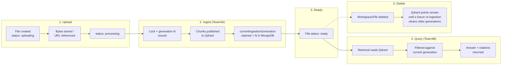

# Database and API Reference

The exact-fields, exact-endpoints reference. For the *why* behind these shapes, see the
[learning/](../learning/) deep-dives; for the presentation-quality diagram version, see
[docs/architecture/](../architecture/). No secrets, real keys, or credentials appear below —
only field names, types, and public configuration values.

## Table of contents

1. [MongoDB collections](#mongodb-collections)
2. [Qdrant collections](#qdrant-collections)
3. [Redis instances](#redis-instances)
4. [Team4A API](#team4a-api)
5. [Team4B API](#team4b-api)
6. [Team4C API (backend-for-frontend)](#team4c-api-backend-for-frontend)
7. [Cross-service data lifecycle](#cross-service-data-lifecycle)

---

## MongoDB collections

Database name must match across all three services (`MONGO_DATABASE_NAME` on Team4A/4B, the
database embedded in Team4C's `MONGODB_URI`) — see
[ENVIRONMENT.md](../ENVIRONMENT.md#cross-service-invariants-must-match-across-services). Owned schema-wise by Team4C
(`team4c/models/*.ts`).

### `users`

| Field | Type | Notes |
|---|---|---|
| `email` | string, unique | lowercased before storage |
| `passwordHash` | string | `select: false` — never returned by a default query |
| `name` | string | |

### `workspaces`

| Field | Type | Notes |
|---|---|---|
| `userId` | ObjectId, indexed | the sole owner — one owner per workspace |
| `name` | string | |

### `files`

| Field | Type | Notes |
|---|---|---|
| `workspaceId` | ObjectId, indexed | |
| `userId` | ObjectId, indexed | denormalized alongside `workspaceId` so an ownership check is one query, not a join |
| `originalName` | string | the human-facing filename Team4C always displays, never Team4B's internal `document_title` |
| `type` | `"pdf" \| "video" \| "youtube_url"` | |
| `status` | `"uploading" \| "processing" \| "ready" \| "failed"` | exactly four values — no fifth "uploaded" state |
| `storageUrl`, `storageProvider`, `publicId` | string | where the bytes live (or the YouTube reference) |
| `processingError` | string \| null | always a fixed, safe message — never raw upstream error text |
| `uploadIdempotencyKey` | string, unique+sparse | client-generated retry-safety key |
| **`currentIngestionGeneration`** | number, default 0 | **the field Team4A's `MongoAuthorityClient` atomically claims.** Team4C never writes to it directly |
| `pageCount`, `durationSeconds`, `sizeBytes` | number | |
| `extractedPages` | array | cached page text, used by a mock Team4B path |

### `conversations`

| Field | Type | Notes |
|---|---|---|
| `workspaceId` | ObjectId, indexed | |
| `title` | string | |
| `ragSessionId` | string, unique+sparse | server-generated only — the key Team4B's Redis session is stored under |
| `sourceScopeDocumentIds` | `string[] \| null` | `null` = whole-workspace; `[]` is a distinct "explicitly scoped to nothing" state |

### `messages`

| Field | Type | Notes |
|---|---|---|
| `conversationId` | ObjectId, indexed | |
| `role` | `"user" \| "assistant"` | |
| `content` | string | |
| `citations` | array of `{fileId, type: "video"\|"pdf", timestampSeconds?, pageNumber?}` | embedded, not a separate collection |
| `createdAt` | date | no `updatedAt` — messages are immutable once written |

## Qdrant collections

| Collection | Written by | Read by | Status |
|---|---|---|---|
| `educopilot_chunks` | Team4A (canonical path only) | Team4B (all retrieval) | **Active** — the one the product actually uses |
| `team4a_ingested_chunks` | Team4A (legacy Celery path) | nothing in the live product | Legacy, unused by the current upload flow |

**Point schema** (per chunk): vector (384-dim, cosine distance) + payload:

| Payload field | Present for | Notes |
|---|---|---|
| `text` | all | the chunk's raw text |
| `chunk_id` | all | deterministic UUID5 — same input always produces the same ID |
| `document_id`, `workspace_id`, `user_id` | canonical only | attached at the identity/generation step |
| `ingestion_generation` | canonical only | what `GenerationAuthorityClient` compares against MongoDB |
| `page_number`, `headings` | PDF only | |
| `start_timestamp`, `end_timestamp`, `frame_reference` | video only | |
| `start_timestamp`, `video_title`, `channel_name`, `source_url` | YouTube only | |

Point IDs are a deterministic UUID5 of `chunk_id` — republishing the same chunk is always a
safe upsert, never a duplicate.

## Redis instances

| Instance | Port | Owner | Holds |
|---|---|---|---|
| Redis A | 6379 | Team4A | Celery broker (db0) / result backend (db1); `IngestionLock` state (canonical locks, legacy dedup locks, stale-job recovery locks) |
| Redis B | 6380 | Team4B | Conversation turn history, keyed `session:{session_id}`, 30-minute TTL |

The two are never shared — a spike in one team's Redis usage can't starve the other's.

## Team4A API

Base URL: `http://localhost:8001` (local dev). All routes except `/health`/`/readyz` require
`Authorization: Bearer <service JWT>` (`scope: ingest`, `aud: team4a-ingestion`).

| Method | Path | Request | Response | Notes |
|---|---|---|---|---|
| `POST` | `/v1/ingest` | `{document_id, file_type, file_url}` | `{document_id, workspace_id, file_type, status, generation}` | **Canonical.** Synchronous. `workspace_id`/`user_id` come from the JWT, never the body |
| `POST` | `/ingest/pdf` | multipart `file` | `JobResponse` | Legacy, Celery-queued |
| `POST` | `/ingest/video` | multipart `file` | `JobResponse` | Legacy, Celery-queued |
| `POST` | `/ingest/youtube` | `{url, language?}` | `JobResponse` | Legacy, Celery-queued, no Hindi fallback |
| `GET` | `/jobs/{job_id}` | — | `IngestionJob` | Legacy job status; triggers stale-job recovery if applicable |
| `GET` | `/jobs` | `?page&page_size` | `JobListResponse` | Legacy job list, paginated |
| `GET` | `/health` | — | `{"status": "healthy"}` | No auth |
| `GET` | `/readyz` | — | `{"status": "ready"/"not_ready", reason?}` | No auth |

**Error responses**: `422` (validation, wrong content-type, oversized upload), `409`
(duplicate content on legacy routes, or lock/authority conflict on canonical), `404` (missing
job, or canonical `MissingFileError`), `502` (canonical fetch/transcript failure), `503`
(Celery dispatch failure).

## Team4B API

Base URL: `http://localhost:8002` (local dev). All routes except `/health`/`/metrics` require
`Authorization: Bearer <service JWT>` (`scope: query`, `aud: team4b-query`); `/query`,
`/query/stream`, and `/evaluate` are additionally rate-limited (30 requests / 60s, keyed by
`sub:workspace_id`).

| Method | Path | Request | Response | Notes |
|---|---|---|---|---|
| `POST` | `/api/v1/query` | `{query, session_id?, retrieval_config?}` | `QueryResponse` | Non-streaming |
| `POST` | `/api/v1/query/stream` | same | NDJSON stream | See [streaming shape](#streaming-response-shape) below |
| `GET` | `/api/v1/sessions/{session_id}/history` | — | `{session_id, history: [...]}` | Full, unwindowed history; 404 if the session doesn't exist |
| `POST` | `/api/v1/sessions/{session_id}/seed` | `{turns: [...]}` | `{session_id, seeded, turn_count}` | Restores a missing/expired session; `seeded: false` is a normal outcome |
| `DELETE` | `/api/v1/sessions/{session_id}` | — | `{session_id, deleted}` | Deleting a non-existent session is a safe no-op |
| `POST` | `/api/v1/evaluate` | `[{query, response, contexts}, ...]` | batch evaluation result | RAGAS metrics; never runs retrieval/generation itself |
| `GET` | `/health` | — | per-component health + derived `rag` rollup | No auth |
| `GET` | `/metrics` | — | `{query_count, average_latency_seconds, hit_rate, error_rate}` | No auth, read-only in-memory snapshot |

**Error responses**: `401`/`403` (JWT/scope failure), `429` (rate limit, with `Retry-After`),
`422` (bad batch size on `/evaluate`), `503` (vector store / Redis / LLM unavailable).

### Streaming response shape

NDJSON, one JSON object per line:
```json
{"type": "delta", "text": "..."}
{"type": "delta", "text": "..."}
{"type": "done", "answer": "...", "grounded": true, "sources": [...], "session_id": "..."}
```
or, on a mid-generation failure after some tokens were already sent:
```json
{"type": "error", "detail": "..."}
```

### `QueryResponse` / citation shape

```json
{
  "answer": "string",
  "grounded": true,
  "sources": [
    {
      "document_id": "string",
      "document_title": "string",
      "chunk_id": "string",
      "relevance_score": 0.0,
      "page_number": 12,
      "section_heading": "string or null",
      "start_timestamp": null,
      "end_timestamp": null
    }
  ],
  "session_id": "string"
}
```
`page_number`/`section_heading` populate for document sources; `start_timestamp`/
`end_timestamp` populate for video/YouTube sources — never both for the same citation.

## Team4C API (backend-for-frontend)

Base URL: `http://localhost:3000`. Public (no session required): `/api/auth/signup`,
`/api/auth/[...nextauth]`. Every other route below requires a valid Auth.js session, checked
independently in the route itself (not solely via `proxy.ts`'s page-level guard).

| Method | Path | Notes |
|---|---|---|
| `POST` | `/api/auth/signup` | Public. Creates a user, returns `{id, name, email}` only |
| `GET`/`POST` | `/api/workspaces` | List (scoped to `session.user.id`) / create |
| `GET`/`DELETE` | `/api/workspaces/[id]` | Get one / cascade-delete (files → messages → conversations → workspace) |
| `GET`/`POST` | `/api/workspaces/[id]/files` | List materials / upload (PDF, video, or YouTube URL) |
| `DELETE` | `/api/workspaces/[id]/files/[fileId]` | Delete one material |
| `POST` | `/api/workspaces/[id]/files/[fileId]/retry` | Retry a `failed` ingestion only (409 otherwise) |
| `GET`/`POST` | `/api/workspaces/[id]/conversations` | Cursor-paginated list / create |
| `DELETE` | `/api/conversations/[id]` | Deletes messages, then the conversation, then best-effort clears the Team4B Redis session |
| `GET` | `/api/conversations/[id]/messages` | Persisted message history for restoration |
| `PATCH` | `/api/conversations/[id]/scope` | Sets `sourceScopeDocumentIds` |
| `POST` | `/api/chat` | Streaming chat — proxies to Team4B, re-verifies citations, persists the exchange |
| `GET` | `/api/local-storage/[...path]` | File serving — session+ownership OR a scoped capability token (for Team4A's own fetch) |

Every workspace-scoped route calls `assertOwnership()` first; conversation-scoped routes
additionally call `assertConversationOwnership()`. Both return an identical 404 whether the
resource doesn't exist or simply isn't the caller's.

## Cross-service data lifecycle



Note the asymmetry in step 5: deleting a `File` in MongoDB does not itself trigger a Qdrant
cleanup — Team4A's cleanup (`delete_older_generations`) only runs as a side effect of a
*successful new ingestion claim* for that same `document_id`, not on delete. This is a real,
current characteristic of the system, worth knowing rather than assuming symmetric cleanup
exists.
