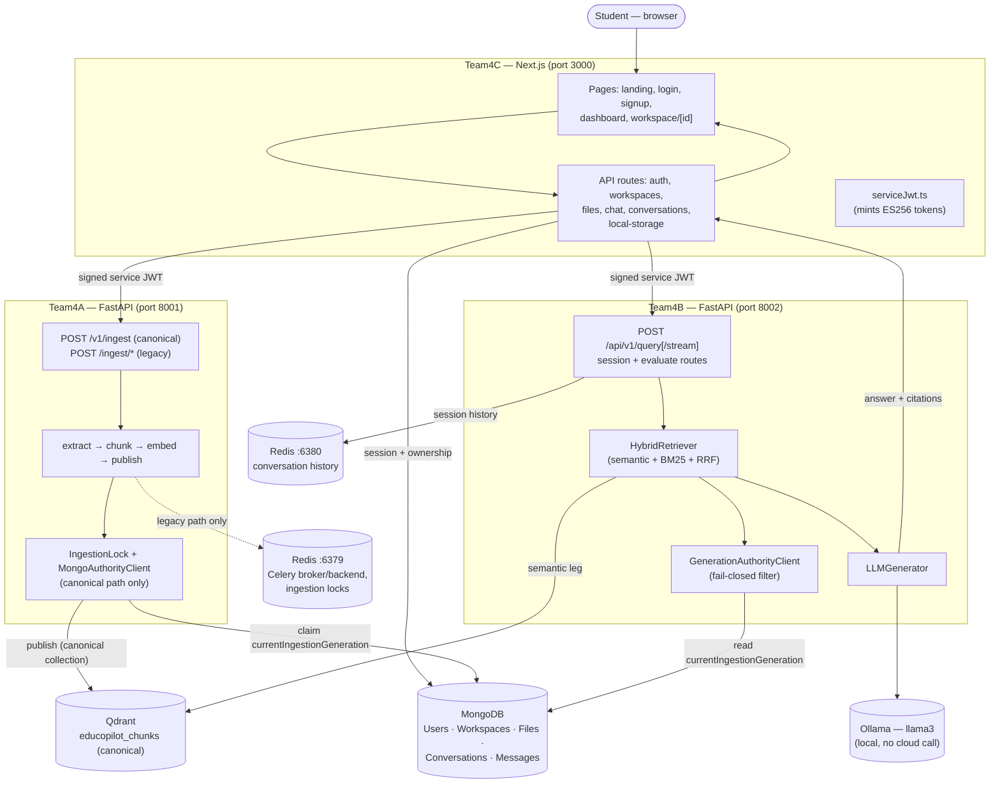
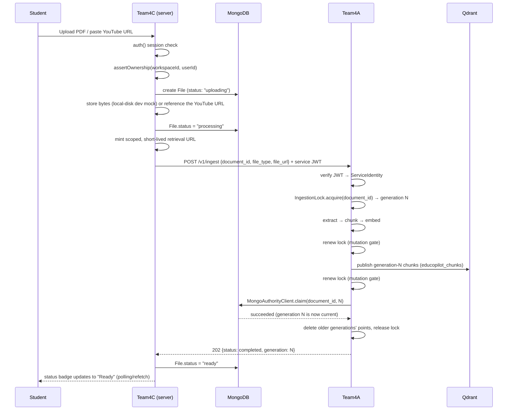
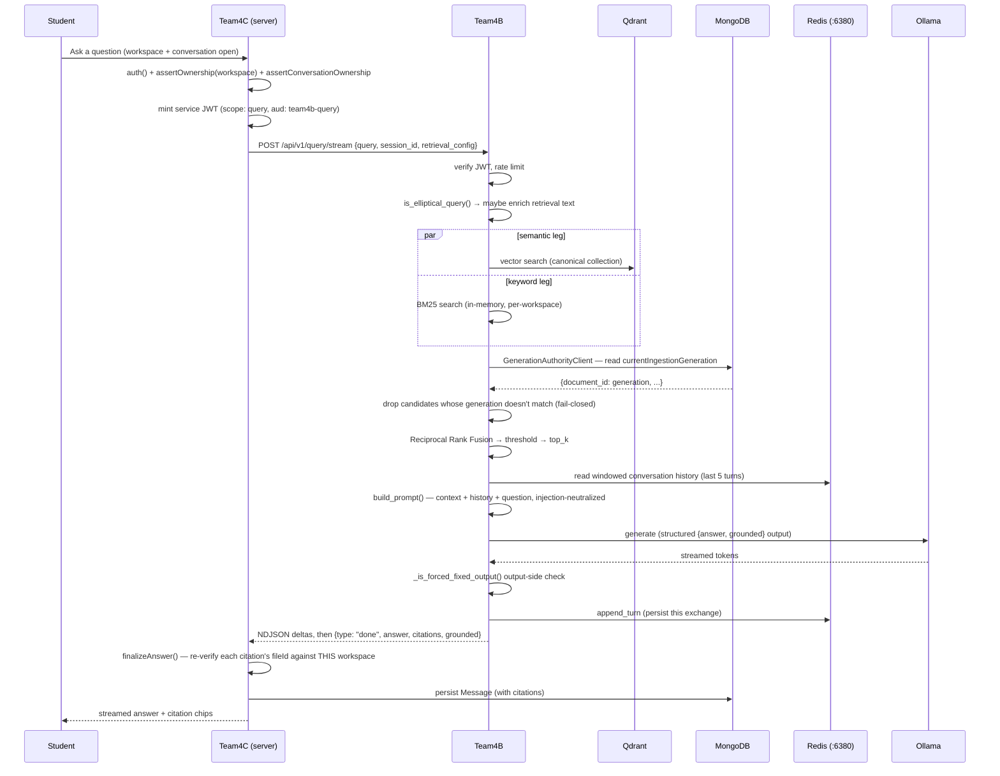
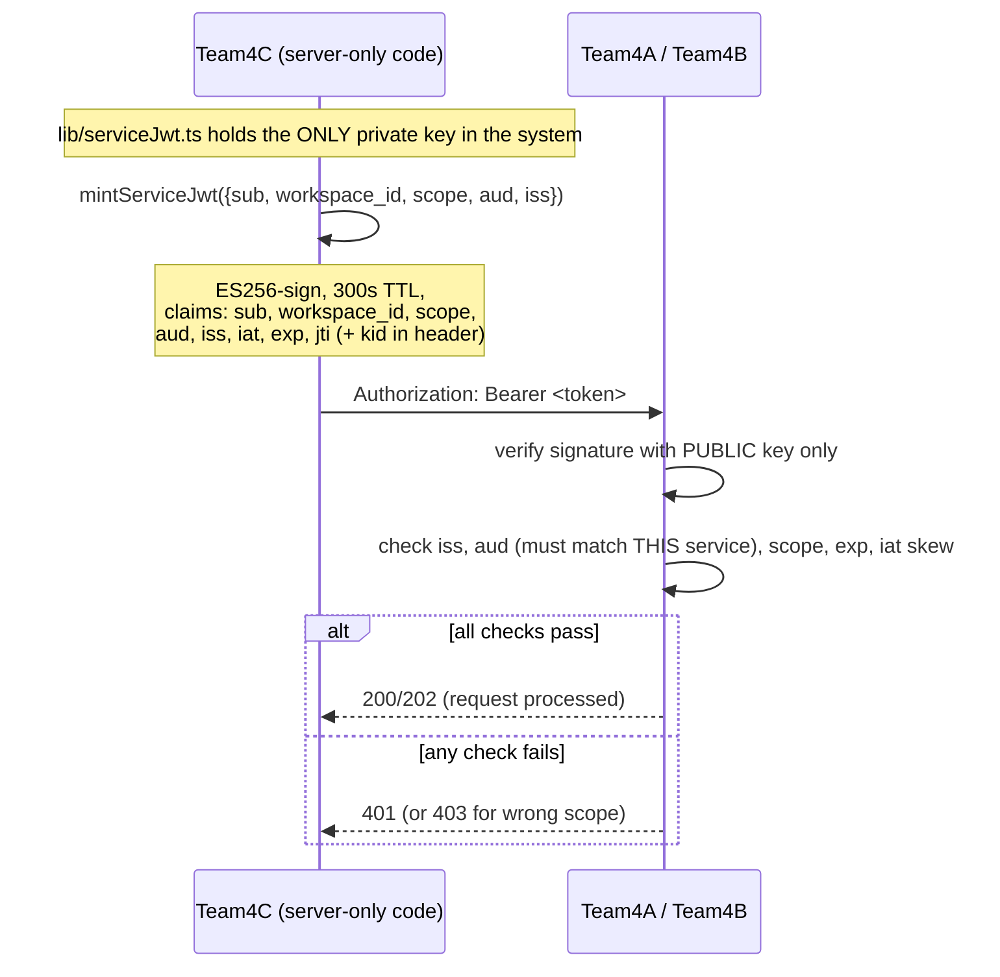
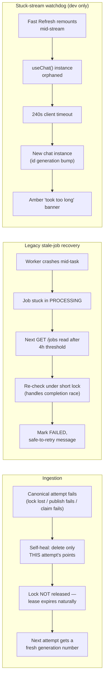

# System Architecture Guide — Full Integration

The deep, diagram-heavy explanation of how Team4A, Team4B, and Team4C actually work together.
For the high-level picture, start with [ARCHITECTURE.md](../ARCHITECTURE.md); for the
presentation-quality diagrams, see [docs/architecture/](../architecture/). This document is
the "how, exactly, step by step" layer underneath both.

## Table of contents

1. [Why three services](#why-three-services)
2. [Complete system map](#complete-system-map)
3. [Sequence: uploading a document](#sequence-uploading-a-document)
4. [Sequence: asking a question](#sequence-asking-a-question)
5. [Service-to-service authentication](#service-to-service-authentication)
6. [Workspace isolation, end to end](#workspace-isolation-end-to-end)
7. [Where each database fits](#where-each-database-fits)
8. [Synchronous vs. asynchronous operations](#synchronous-vs-asynchronous-operations)
9. [Error, retry, and recovery paths](#error-retry-and-recovery-paths)
10. [Conversation persistence and streaming](#conversation-persistence-and-streaming)
11. [Local startup order](#local-startup-order)

---

## Why three services

Team4A (ingestion) and Team4B (retrieval/generation) have deliberately different scaling and
failure profiles: ingestion is bursty, CPU/IO-heavy, and can take minutes for a large video;
retrieval needs to stay responsive under live chat load. Splitting them means one team's bug or
one service's outage doesn't take the other down with it, and each can be reasoned about,
tested, and (in principle) scaled independently. Team4C owns everything user-facing — auth,
ownership, the UI — and is the only service a browser ever talks to; Team4A and Team4B are
never reachable from outside the local network, only from Team4C's own server-side code (see
[Service-to-service authentication](#service-to-service-authentication)).

## Complete system map

Full technical detail (ports, exact endpoints, JWT claims): see
[DATABASE_AND_API_REFERENCE.md](DATABASE_AND_API_REFERENCE.md) and
[docs/architecture/ARCHITECTURE_REFERENCE.md](../architecture/ARCHITECTURE_REFERENCE.md).

## Sequence: uploading a document

Covers the canonical path — the one the real product uses
(see [TEAM4A_DEEP_DIVE.md](../learning/TEAM4A_DEEP_DIVE.md) for the legacy alternative).

If any step from lock-acquire through the Mongo claim fails, Team4A self-heals by deleting
exactly the points that specific attempt published and does **not** release the lock — see
[TEAM4A_DEEP_DIVE.md](../learning/TEAM4A_DEEP_DIVE.md#the-canonical-path--identity-locking-and-generations)
for why. Team4C maps the resulting failure through `describeIngestionFailure()` into a fixed,
safe message (`File.processingError`) — never raw error text.

## Sequence: asking a question

Note the two independent citation checks: Team4B builds citations only from retrieval
metadata (never model free-text), and Team4C independently re-verifies each one against the
active workspace before rendering — see
[TEAM4C_DEEP_DIVE.md](../learning/TEAM4C_DEEP_DIVE.md#citations-and-the-second-layer-of-trust).

## Service-to-service authentication

Why `aud` matters concretely: a token minted with `aud: team4a-ingestion` is cryptographically
valid but will be **rejected by Team4B** even if somehow replayed there, because Team4B checks
`aud == team4b-query` independent of signature validity — see
[TECHNOLOGY_DECISIONS.md](TECHNOLOGY_DECISIONS.md#jwt--es256-service-to-service-auth).

## Workspace isolation, end to end

Isolation is enforced at three independent layers — not one:

1. **Team4C, at the API boundary**: every workspace-scoped query is filtered by
   `session.user.id`/`workspace_id`, and `assertOwnership()` returns an identical 404 for
   "doesn't exist" and "isn't yours," so the ID space itself isn't probeable.
2. **Team4B, at retrieval time**: `workspace_id` comes only from the verified JWT (never a
   request-body field an attacker could set), and both the semantic and BM25 legs are scoped to
   that workspace before any ranking happens — a BM25 index is even rebuilt fresh per query per
   workspace so a foreign document can't influence term-rarity statistics.
3. **Team4C, again, after Team4B responds**: citations are re-checked against the active
   workspace's own file list before being shown — defense-in-depth against a hypothetical bug
   on Team4B's side, not reliance on it being perfect.

## Where each database fits

| Store | Owner | Holds | Who else touches it |
|---|---|---|---|
| MongoDB | Team4C (schema) | Users, Workspaces, Files, Conversations, Messages | Team4A writes only `File.currentIngestionGeneration`; Team4B reads only that same field |
| Qdrant | Team4A (writer) | `educopilot_chunks` — chunk text + embedding + metadata | Team4B reads (semantic search); nothing else touches it |
| Redis :6379 | Team4A | Celery broker/result (legacy path only), `IngestionLock` state | Not shared with Team4B |
| Redis :6380 | Team4B | Conversation turn history, session TTL | Not shared with Team4A |

No database is shared for its *primary* purpose across services — the one deliberate exception
is the single `currentIngestionGeneration` field, a narrow, specific hand-off point, not a
general shared-schema arrangement.

## Synchronous vs. asynchronous operations

| Operation | Sync or async | Why |
|---|---|---|
| Canonical ingestion (`POST /v1/ingest`) | **Synchronous** | The caller (Team4C) needs a definite success/failure result to update `File.status` immediately; the lock/generation mechanism requires a single, ordered attempt anyway |
| Legacy ingestion (`POST /ingest/pdf` etc.) | **Asynchronous** (Celery) | Historical design — the client polls `GET /jobs/{id}` for status |
| A query (`/api/v1/query`) | Synchronous (blocking on the full answer) | Simpler client code where streaming isn't needed |
| A streaming query (`/api/v1/query/stream`) | Asynchronous from the client's view (NDJSON stream) | Lets the UI show tokens as they're generated, given multi-second-to-two-minute local LLM latency |

## Error, retry, and recovery paths

Retrieval-side failures fail closed, not open: a generation-authority lookup failure excludes
the affected candidates rather than trusting them (see
[TEAM4B_DEEP_DIVE.md](../learning/TEAM4B_DEEP_DIVE.md#generation-authority-filtering)); a
rate-limiter Redis failure, by contrast, fails **open** (lets the request through) — a
deliberate, different choice for a different kind of risk, not an inconsistency.

## Conversation persistence and streaming

Team4B's Redis-backed conversation history is fast but short-lived (30-minute TTL, refreshed
only on write). Team4C's MongoDB `Message` collection is the durable record. When a
conversation is reopened after Team4B's session has expired, Team4C's
`restoreSessionIfMissing()` reads the most recent messages from Mongo and re-seeds Team4B's
Redis session before the next query — so a student never loses context just because they
stepped away for half an hour, without Team4B needing to know anything about MongoDB's schema
beyond the one narrow generation field it already reads.

## Local startup order

Infrastructure (MongoDB, Redis ×2, Qdrant, Ollama) → Team4A → Team4B → Team4C. Team4A/Team4B
have no hard dependency on each other at startup, but both need their respective Redis and
Qdrant/Mongo reachable; Team4C needs Team4A and Team4B's URLs configured (even if those
services aren't up yet — Team4C's clients fail per-request, not at its own startup). Full exact
commands: [SETUP.md](../SETUP.md#part-e--start-infrastructure-first).
